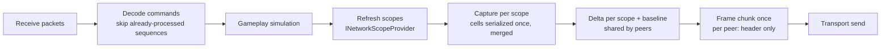
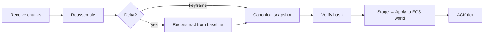
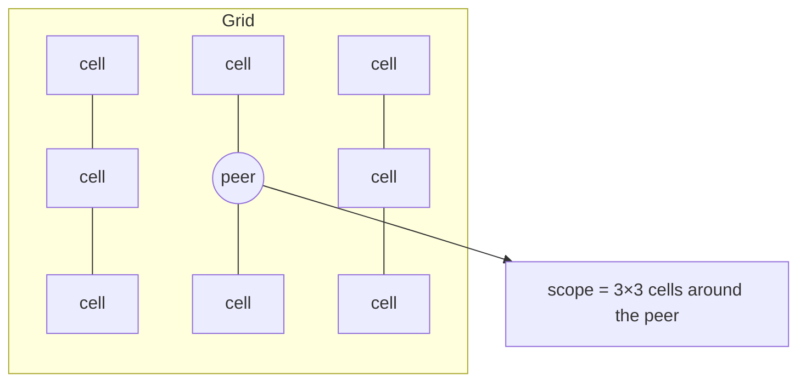

# Static ECS Network

Transport-neutral protocol and replication for Static ECS: server-authoritative snapshots,
client commands, deltas, recovery. Protocol **v17**.

## Server tick



- **Capture:** one canonical snapshot per scope per tick, sorted by entity GID.
- **Delta:** encoded against the tick each peer acknowledged. Peers with the same scope and
  baseline share the same delta and framed chunk; only the packet header is per peer.
- **Keyframe:** sent when a peer has no usable baseline, requested a resync, or changed scope.

## Client

`NetworkClient<TWorld>.CapturePingDiagnostics()` exposes allocation-free jitter and
unanswered-probe counters for the current connection. Only locally accepted
clock-sync pings are counted; a pong arriving after three seconds does not turn a
timed-out probe into an answer. `Disconnect()` clears the sample window.



- The ACK advances only after a successful apply; that tick becomes the next baseline.
- A failed apply requests recovery; a bad delta requests a keyframe.
- A delta from a previous scope that is still in flight after a scope change is dropped as
  `ScopeStale`: no error, no recovery.

## Delta wire format

| Operation | Encodes |
|---|---|
| `Remove` | Position in the baseline (varint skip) |
| `Add` | Full entity bytes |
| `PatchFast` | Skip + 2-bit mask per record (changed, disabled) + changed payloads |
| `PatchFull` | Records added or removed on an entity |

- Unchanged entities and records cost 0 bytes.
- Components implementing `INetworkComponentDelta` send a value delta against the baseline
  record instead of the raw payload (for example position XOR, changed animation fields).
- A moving entity costs about 10 bytes (it was 44 in v7).
- The Burst backend plans the delta structure; managed code writes every byte. Output is
  byte-identical to the portable encoder.

## Server settings

`NetworkServerSettings` carries the server behaviour values that are not part of the wire
format; pass it as the `settings` argument of `NetworkServer<TWorld>`, or leave it null for the
defaults. The server validates and copies the values when it is created.

| Setting | Default | Meaning |
|---|---:|---|
| `MinimumHistoryTicksPerScope` | 32 | History ticks a scope keeps whatever its share of the history bytes |
| `MinimumHistoryBytesPerScope` | 64 KiB | History bytes a scope keeps however many scopes share the history bytes |
| `MaximumPendingCommandsPerPeer` | 765 | Queued commands one peer may hold before its batches are rejected |
| `MaximumPendingCommandBytesPerPeer` | 256 KiB | Queued command bytes one peer may hold |
| `CommandPastWindowTicks` / `CommandFutureWindowTicks` | 2 / 8 | How far a command's target tick may trail or lead the server tick |
| `RecoveryRetryTicks` | 10 | Ticks between two recovery snapshots for a peer that keeps asking for a resync |
| `OwnerStateIntervalTicks` | 5 | Ticks between two comparisons of a peer's owner state |
| `CellCacheStaleTicks` | 64 | Ticks after which the capture of an unrequested cell leaves the cache |
| `UnreliableDeltaChunks` | 0 | Datagram-sized chunks a delta may need and still travel unreliably; 0 keeps every snapshot reliable |
| `UnreliableDeltaLostTicks` | 10 | Ticks after which an unacknowledged unreliable delta leaves the in-flight window |

The snapshot history size stays in the `historyTicks` and `historyBytes` constructor arguments.

## Snapshot delivery

By default every snapshot chunk travels on the reliable ordered channel: nothing is lost, but
one lost datagram holds every later snapshot until it is resent. With `UnreliableDeltaChunks`
above zero a delta is sent with `PacketFlags.UnreliableSequenced` when it fits that many chunks
of `MaxUnreliablePayloadBytes`. A lost or late delta is not resent: the next one is encoded
against the baseline the peer last acknowledged and supersedes it, and the client drops whatever
is older than the snapshot it applied. Losing one chunk of a delta loses that delta; chunks that
arrive in the wrong order still assemble, as long as the transport delivers both (the LiteNetLib
adapter does, the Unity Transport adapter keeps its sequenced pipeline and drops the late one).

These stay reliable: keyframes (a scope change sends one), a delta that needs more chunks than
allowed, and a delta whose own-entity state does not fit behind its last chunk. A reliable and
an unreliable snapshot may overtake each other; the client orders them by tick.

The client acknowledges a snapshot the way it arrived: a keyframe and a reliable delta with a
reliable `Ack`, an unreliable delta with an unreliable one. An acknowledgement is cumulative,
so the next one covers a lost one, and a late one below the acknowledged tick is ignored; a
resend would only hold the later acknowledgements behind the lost packet. Unreliable
acknowledgements share the packet numbering of command batches, not the reliable one.

With `Windowed` admission an unreliable delta the peer did not acknowledge within
`UnreliableDeltaLostTicks` stops counting toward the window; otherwise a peer that lost a whole
window of deltas would never be sent another. A reliable snapshot, keyframe or delta, keeps its
slot until it is acknowledged. While a keyframe is due, every unacknowledged delta leaves the
window at once and only a keyframe keeps the slot: the keyframe replaces the deltas, and waiting
for an acknowledgement that may never come would hold it back for good. That covers a reliable
delta too, because the client drops, without an acknowledgement, a reliable delta that a later
unreliable one overtook. `ApplicationAck` admission waits for the exact tick and cannot be
combined with unreliable deltas.
`NetworkReplicationDiagnostics` counts the deltas sent unreliably (`DeltaSnapshotsUnreliable`)
and the ones that left the window unacknowledged, by the timeout or for a due keyframe
(`UnreliableDeltaWindowExpirations`), and the
acknowledgements that arrived unreliably (`UnreliableAcknowledgements`); with
unreliable deltas `DeltaSnapshotsOverDatagram` counts the ones of more than one chunk. The
delivery-phase diagnostics cover reliable snapshots only.

## Client settings

`NetworkClientSettings` carries the client behaviour values that are not part of the wire
format; pass it as the `settings` argument of `NetworkClient<TWorld>`, or leave it null for the
defaults. The client validates and copies the values when it is created.

| Setting | Default | Meaning |
|---|---:|---|
| `SnapshotAssemblyTimeoutSeconds` | 2 | How long a snapshot split into chunks may stay incomplete before the client drops it and asks for a resync |
| `AcknowledgementSendTimeoutSeconds` | 5 | How long an acknowledgement may wait for the transport before the client disconnects |
| `ClockProbeIntervalSeconds` | 1 | Time between two clock probes of `SynchronizeClock` |
| `RoundTripSmoothing` | 0.2 | Weight of a new sample in the smoothed round-trip time, in (0, 1] |
| `MaximumPendingOwnedEntityRefreshes` | 16 | Own-entity states kept while the snapshot of their tick has not arrived |

The prediction lead stays in the `predictionLeadTicks` constructor argument.

## Snapshot admission

`NetworkServer<TWorld>` defaults to `NetworkSnapshotAdmissionMode.Current`, which preserves
the existing transport-reported pending-reliable behavior: the next snapshot waits until the
transport has no reliable packet pending, including packets that are merely awaiting their
delivery callback, so the cadence is bounded by one snapshot per round trip plus the owner's
poll interval.

`Windowed` admits a snapshot while the peer holds fewer than `maxSnapshotsInFlight` (default
2, at most 8) unacknowledged snapshot ticks and the transport reports no reliable packet still
queued ahead of native submission (`INetworkReliableBacklogState`; a transport without that
interface falls back to `INetworkReliableSendState`). While no baseline is acknowledged or
recovery is pending, the window is one: an unacknowledged keyframe is never repeated. The
in-flight set is released by the cumulative ACK, by a scope change, by a resync request and
by a baseline gap, so a keyframe the peer asked for never waits behind stale deltas. Deltas are still encoded against the acknowledged baseline, so peers sharing a scope
and a baseline keep sharing the encoded chunk. `SnapshotWindowDeferrals` counts snapshots held
back by the window alone.

The opt-in `ApplicationAck` mode admits at most one fully accepted snapshot batch per peer
until that peer acknowledges its exact snapshot tick. Acknowledgements for unoffered ticks do not
advance the delta baseline; gaps request keyframe recovery. A partially accepted recovery
keyframe is retried at a bounded simulation-tick cadence. This is diagnostic admission
policy only: it does not change packet ordering, flags, snapshot contents, or the wire
protocol. The game's runtime config restricts this experiment to UTP; production remains on
the default `Current` mode unless a separate change is approved.

Transports may implement `INetworkReliableDeliveryObservation` to expose the latest
snapshot callback's server tick and owner-side Stopwatch timestamp. Zero timestamp means
unavailable. `CallbackToSnapshotAdmission` measures that matching callback to the next
fully accepted batch; rejected and partial submissions do not consume an observation.
Scope/recovery resets discard diagnostic correlation without changing admission behavior.
These timestamps describe owner callback processing, not native ACK completion.

## Interest management



- **`INetworkScopeProvider<TWorld>`** assigns each peer a scope every tick and lists the
  scope's entities. Without a provider there is one global scope.
- **`INetworkCellularScopeProvider<TWorld>`** also exposes a scope's cells. Capture then
  serializes each cell once per tick and builds every scope by merging cell blocks.
- Cellular merge capture rents the exact merged-payload size by default (including the canonical
  entity-count header), bounded by `ProtocolLimits.MaxDecodedPayloadBytes`. This changes only pool
  sizing: bytes, ordering, AOI selection and the wire contract stay unchanged. Each returned
  snapshot owns its lease until `Dispose()`; the internal test switch can select the baseline
  capacity path when comparing allocation behavior.
- **Scope change:** the peer gets one keyframe of the new scope; the scope travels in the chunk
  header. Acks of old-scope snapshots still on the wire are ignored, so they cannot repeat it.
- **History:** all scope histories share one byte budget, but each scope keeps at least 32 ticks of
  its own captures. An ack of an evicted tick costs a keyframe, whose size delays the next acks, so
  a shorter floor turns a loaded scope into a keyframe loop. A dense scope can exceed its share.
- **`INetworkOwnerStateProvider<TWorld>`**, published through `NetworkOwnerStateResource<TWorld>`
  on the authority world, marks entities only their owner may see. Capture drops them from every
  scope snapshot, and the peer gets the full list of its own in a reliable `OwnerState` packet only
  when its bytes change, checked every 5 ticks. On the client those replicas stay out of the removal
  diff and public snapshots until they leave the list; the next snapshot then decides their fate.
- **`INetworkUpdatePolicy<TWorld>`** can hold an entity: its previous bytes are reused, so it
  costs nothing in the delta. Owned entities and keyframes are always fresh.
- **`INetworkScopeCaptureBudgetPolicy<TWorld>`** limits the bytes of changed entities one cellular
  scope snapshot refreshes per tick. Changed entities are ranked by `Weight * (captures waited + 1)`;
  the ones that do not fit keep the bytes of the scope's previous snapshot. An unchanged entity is
  free, an entity new to the scope or one that waited `MaximumWaitTicks` is always refreshed. The
  queue is priced in priority order and a capture stops once `MaximumMisses` candidates did not fit,
  so a cheap low-priority change does not always take the room an expensive one left. With
  `RefreshesObserversPersonally` the entity of a peer observing the scope waits like the rest, and
  that peer gets its current state with the snapshot of the same tick; the client applies it right
  after that snapshot, so prediction never reconciles against the held state. The state carries only
  the records that differ from the block that snapshot holds (`OwnedEntityRefreshPayload`), or the
  whole block when the record sequence changed. It rides as the trailer of the last snapshot chunk
  packet: `PacketHeader.TrailerLength` bytes at the end of the payload belong to that peer, the
  bytes before them are the chunk payload every peer of the same baseline shares. A state longer
  than 255 bytes, or one the last chunk has no room for, goes ahead of the snapshot in an
  `OwnedEntityRefresh` packet instead. Without the option such an entity is refreshed in every
  capture.

## Replication diagnostics

- **`NetworkServer.CaptureReplicationDiagnostics()`** copies cumulative counters: capture
  failures per `SnapshotCaptureResult`, entities and canonical bytes per scope capture
  (`NetworkValueHistogram`, eight sub-buckets per power of two), accepted keyframes and deltas
  apart, and the entities each accepted delta adds, removes and patches for its peer. It
  allocates; read it at sample boundaries, not per tick.
- **`EnableReplicationCensus(intervalTicks)`** is off by default. Every `intervalTicks`-th offered
  tick it compares each captured scope with that scope's previous-tick capture and counts, per
  entity kind, world and observed entities, changed entities and scope entries/exits, plus
  records re-serialized byte-identical (the upper bound of false `Changed` marks under
  dirty-on-access tracking). It reads captures only; snapshots and the wire stay unchanged.

## Client options

| Option | Effect | Default |
|---|---|---|
| `NetworkReplicaSkipPolicy<TWorld>` | Skip apply for entities whose bytes did not change | Off: prediction writes replicated components |
| `canonicalOnlyApply` | Accept a verified snapshot as baseline without an ECS world | Off: used by light load clients |
| `NetworkReconstructionCache` | Share delta reconstruction between clients in one process | Off: used by the load generator |

## Link relay

`NetworkLinkRelay` impairs a real connection without touching either endpoint: a client connects
to a loopback port of its own process, and the relay forwards its UDP datagrams to the server and
back with delay, jitter and loss. It sits below the transport, so the transport's retransmits,
acknowledgements and round-trip estimate react as they do on a bad network. A decorator above
`INetworkTransport` cannot do that: it would delay packets the transport has already acknowledged.

```csharp
using var relay = new NetworkLinkRelay();
var link = relay.Open(serverAddress, serverPort,
    new NetworkLinkImpairment { LatencyMs = 75f, JitterMs = 20f, LossPercent = 1f });
settings.Address = NetworkLinkRelay.LoopbackAddress;
settings.Port = (ushort)link.LocalPort;      // the client now connects through the link
link.Impairment = default;                   // values change while the connection lives
link.Blackout(500f);                         // a lag spike: both directions drop for 500 ms (at most MaximumBlackoutMs)
```

- `NetworkLinkImpairment` applies to each direction on its own: a round trip gains twice
  `LatencyMs` and can lose a datagram on either leg. Jitter is a uniform spread around the
  latency, so neighbouring datagrams reorder.
- One link serves one client socket: its first sender becomes its only client. A client that
  reconnects from a new socket needs a new link; close the old one with `relay.Close(link)`.
- A link listens on the loopback address only and runs one thread per direction; the relay runs
  one more thread for the delayed datagrams. A clean link forwards on the receiving thread without
  queueing.
- `CaptureDiagnostics()` counts forwarded, delayed and dropped datagrams per direction and the
  delay queue levels. A datagram above `MaximumDatagramBytes` (2048 by default) or one that does
  not fit the delay queue is dropped and counted.
- The relay needs sockets and threads, so it does not run on WebGL. Use it for debugging and load
  tests only.

## Usage

Declare reachable roots in each composition assembly; generated schemas provide
serialization and registration:

```csharp
[assembly: NetworkEndpoint("Authority", typeof(Main), NetworkRole.Server,
    typeof(MoveInput), typeof(NetworkOwnerComponent))]

[assembly: NetworkEndpoint("Client", typeof(ClientWorld), NetworkRole.Client,
    typeof(MoveInput), typeof(NetworkOwnerComponent))]
```

Gameplay features own command cadence, server policy, simulation, prediction and
presentation; see the
[network feature development guide](../../../docs/guides/network-feature-development.md).

## Contract

- Both endpoints must match the protocol version and the schema, simulation and content fingerprints.
- Tick commands are unreliable with redundancy; transactions and snapshots are reliable.
- Command batches obey `MaxUnreliablePayloadBytes`; snapshot chunks obey `MaxReliablePayloadBytes`.
- Every buffer lease is consumed, transferred or disposed on every path. A received lease
  caches its decode result, so a packet is hashed once.
- Compression, authentication, encryption and server rewind are out of scope.
- Architecture: [network-static-ecs.md](../../../docs/guides/network-static-ecs.md).
